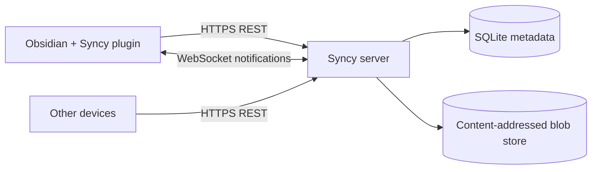

<div align="center">

<h1>Syncy for Obsidian</h1>

<p><strong>Your vault. Your server. Everything in sync.</strong></p>

<p>The companion Obsidian plugin for the self-hosted Syncy server.</p>

<p>
  
  
  
  
  
  
  
</p>

</div>

> [!WARNING]
> **Vibecoded.** Syncy was built with heavy AI assistance. It has an integration test suite and is designed carefully, but it is young software. Review the code, run the tests, keep independent backups, and do not treat this plugin as the only copy of important data.

> [!NOTE]
> **Open code and public repository, free to use.** The complete source is available to clone, fork, modify and self-host. You may **not** sell it or publish a paid version. Read the [license](#license).

Syncy for Obsidian is the client half of a two-part self-hosted sync stack. The Syncy server lives in a separate repository. The server is content-agnostic, so note sync, attachment sync, plugin sync, theme sync and vault-configuration sync all use the same reliable file protocol.

> [!IMPORTANT]
> Syncy is **not** compatible with Obsidian's official, private Sync protocol. It implements a clean API for its own companion plugin. It is also not affiliated with or endorsed by Obsidian.

## Contents

- [Why Syncy](#why-syncy)
- [What gets synced](#what-gets-synced)
- [Architecture](#architecture)
- [Installation](#installation)
- [Plugin setup](#plugin-setup)
- [Vault settings sync](#vault-settings-sync)
- [Large-vault reliability](#large-vault-reliability)
- [Configuration](#configuration)
- [Sync model](#sync-model)
- [Commands and recovery](#commands-and-recovery)
- [Security](#security)
- [Documentation](#documentation)
- [Development](#development)
- [Contributing](#contributing)
- [License](#license)

## Why Syncy

| | |
| --- | --- |
| **Your infrastructure** | Your server, your disk, your rules. No monthly per-vault sync bill. |
| **Everything syncs** | Notes, attachments, folders, community plugins, plugin data, themes, snippets, hotkeys and settings. |
| **Conflict-safe** | Per-file revisions, path conflict detection, atomic multi-file batches and tombstones. |
| **History included** | Every accepted change is versioned. Browse, preview and restore old note or file versions. |
| **Encryption optional** | E2EE vaults store opaque paths and ciphertext. The server never receives the vault key. |
| **Large vaults first** | Paginated snapshots, content-addressed blobs, target-only conflict checks and indexed change feeds. |
| **Real-time** | WebSocket notifications wake clients immediately. The durable change feed does the rest. |
| **Multi-device** | Device registration, rotating refresh tokens, reuse detection and instant device revocation. |
| **Obsidian-native** | Works on desktop and mobile with no Node-only APIs in the sync path. |

## What gets synced

| Category | Examples | How it syncs |
| --- | --- | --- |
| Notes | Markdown, Canvas, databases, text files | File content + path + version history |
| Attachments | Images, audio, video, PDFs, archives | Content-addressed blobs, deduplicated |
| Folders | Empty folders and directory structure | Folder records in the change feed |
| Plugin bundles | `.obsidian/plugins/**/main.js`, `manifest.json`, `styles.css` | Normal file sync |
| Plugin data | `.obsidian/plugins/**/data.json` | Normal file sync; opt-in, use E2EE for credentials |
| Vault settings | `.obsidian/app.json`, `appearance.json`, `hotkeys.json`, `core-plugins.json`, `community-plugins.json` | Raw file sync, rescanned every sync |
| Themes and snippets | `.obsidian/themes/**`, `.obsidian/snippets/**` | Normal file sync |
| Workspace state | `workspace.json`, `workspace-mobile.json` | Excluded by default; usually device-specific |
| Deletions | Files removed on any device | Tombstones in the change feed |
| Renames | Path changes, including swaps | Stable file IDs and atomic path resolution |

The plugin does not parse Markdown or plugin bundles. That means new Obsidian file formats, community plugins and future vault features work without plugin changes.

## Architecture



- **Obsidian + TypeScript** provide the plugin UI, settings, file watcher and sync engine.
- **Web Crypto** provides SHA-256 hashing and optional AES-256-GCM encryption on desktop and mobile.
- **A durable local state file** stores the cursor, file-ID map, revisions and write-ahead pending queue.
- **The server** stores accounts, devices, vaults, memberships, file metadata, versions and the change log in SQLite, plus content-addressed blobs.
- **The WebSocket** is only a notification channel. The durable change feed is the source of truth.

## Installation

Requirements: Obsidian 1.6 or newer and a reachable Syncy server. Node.js 22 or newer is required only to build the plugin.

Syncy is not in the community plugin store yet. Build it and copy the result into your vault:

```bash
git clone https://github.com/zazikii/Syncy-Obsidian-Plugin.git
cd Syncy-Obsidian-Plugin
npm install
npm run build
```

Copy `main.js`, `manifest.json` and `styles.css` into:

```text
<your-vault>/.obsidian/plugins/syncy/
```

Then open **Settings → Community plugins**, reload Obsidian, and enable **Syncy**.

For development, link the repository into your vault and run the watch build:

```bash
# macOS / Linux
ln -s "$(pwd)" "<your-vault>/.obsidian/plugins/syncy"

# Windows PowerShell (run as administrator)
New-Item -ItemType Junction -Path "<your-vault>\.obsidian\plugins\syncy" -Target "<repo>"

npm run dev
```

## Plugin setup

1. Start your Syncy server and create the account from its `.env` or with `POST /v1/setup`.
2. Open **Settings → Syncy**.
3. Enter the server URL, email and password, then click **Sign in**.
4. Choose an existing remote vault and click **Link**, or enter a name and click **Create vault**.
5. If the vault is end-to-end encrypted, enter the E2EE passphrase when prompted.

Syncy immediately runs an initial sync:

1. The server snapshot is downloaded page by page.
2. Local files are compared with the snapshot.
3. Local-only files are queued for upload.
4. Changes that happened during the snapshot are replayed from the change feed.

For a large existing vault this may take a while. The status bar shows progress.

### Multiple devices

Repeat the setup on each device and link the **same** remote vault. Devices authenticate with their own refresh token and appear separately in the server's device list.

Never link two different remote vaults to the same local Obsidian vault at the same time.

## Vault settings sync

The plugin syncs vault configuration as raw `.obsidian` files, closest to Obsidian Sync:

```text
.obsidian/app.json
.obsidian/appearance.json
.obsidian/hotkeys.json
.obsidian/core-plugins.json
.obsidian/community-plugins.json
.obsidian/themes.json
.obsidian/themes/**
.obsidian/snippets/**
.obsidian/plugins/** (bundles, manifests and styles)
```

This gets version history and the same conflict rules as notes.

The **Sync** section of the settings controls what is included:

- **Sync Obsidian configuration** includes the files above.
- **Sync workspace layout** is off by default because layouts are usually device-specific.
- **Sync community plugin data** is off by default because plugin `data.json` files may contain API keys and tokens. Prefer an E2EE vault if you enable it.
- **Excluded paths** accepts one vault-relative glob per line (`*`, `**`, `?`).

Syncy rescans `.obsidian` on each sync because Obsidian does not consistently emit vault events for its configuration directory. This also catches settings changed while the plugin was disabled.

When both raw config sync and another settings mechanism are used, pick one source of truth to avoid loops. The structured `/v1/vaults/:id/settings` document is not used by this plugin.

## Large-vault reliability

A vault with 100,000 notes or a large attachment library must never become one giant JSON response or an O(vault) operation on every save.

| Concern | Approach |
| --- | --- |
| Initial sync | Paginated snapshot, 1–1000 files per page, stable first-page revision |
| Remote updates | Paginated change feed ordered by revision |
| Local pushes | Batched changes with per-file expected revisions |
| Path checks | Only paths touched by the batch are queried, not the entire vault |
| Large attachments | Content-addressed blobs; the plugin buffers through Obsidian's `requestUrl` |
| Storage growth | Content-addressable deduplication, version retention and server GC |
| SQLite performance | WAL mode plus server-side indexes for revisions, paths, versions and blobs |
| Request limits | 8 MiB JSON bodies, 512 MiB blobs, 6000 requests/minute by default |
| Real-time | WebSocket is a hint; clients pull the durable change feed |
| Crash safety | Idempotent applies, durable cursors, a write-ahead pending queue and atomic file writes |
| Upload pressure | Bounded upload concurrency and automatic backoff on `429` |

The integration suite includes initial import, edits, renames, deletes, path swaps, conflicts, stale cursors, remote moves/deletes and encrypted sync against a live server.

> [!TIP]
> For very fast initial imports, raise `RATE_LIMIT_MAX` on the server. For vaults with many large attachments, keep the server's data directory on an SSD and back it up regularly.

## Configuration

Plugin settings live in **Settings → Syncy**. They are stored in the plugin's local `data.json`; the vault link, cursor and pending queue live in `sync-state/`.

| Setting | Description |
| --- | --- |
| **Server URL** | Base URL of your Syncy server, without `/v1`. Locked while signed in. |
| **Email** | Account email on the server. |
| **Password** | Used once to sign in. Not stored by the plugin. |
| **Device name** | Name used for new sign-ins and reconnects. |
| **Remote vault** | Existing server vault to link, or a name for a new vault. |
| **End-to-end encryption** | Create a new E2EE vault with a passphrase. |
| **Link / Relink / Unlink** | Start or stop syncing without deleting remote data. |
| **E2EE passphrase** | Unlock an encrypted vault on this device. Never sent to the server. |
| **Remember key** | Persist the unlocked vault key in local plugin data. |
| **Enable sync** | Turn syncing on or off for the linked vault. |
| **Real-time notifications** | Keep a WebSocket open for immediate remote updates. |
| **Sync on startup** | Run a sync as soon as Obsidian opens. |
| **Polling interval** | Seconds between periodic checks; `0` disables the timer. |
| **Sync Obsidian configuration** | Include `.obsidian` settings, themes, snippets and plugins. |
| **Sync workspace layout** | Share device-specific workspace files. |
| **Sync community plugin data** | Include plugin `data.json` files. |
| **Excluded paths** | One vault-relative glob per line. |
| **Manual sync** | Sync now, full resync or reset local state. |

## Sync model

```text
1. Sign in with email + password. Keep the rotating refresh token safe.
2. Link an existing vault or create a new one. Subscribe to it over WebSocket.
3. For each changed file:
     a. Debounce the watcher and compute SHA-256.
     b. Upload the blob if it is not already on the server.
     c. Push a change with expectedRevision (or null for a new file).
4. Other devices receive a vault_changed hint and pull changes since their cursor.
5. On a conflict, pull the server state and merge, overwrite deliberately, or create a conflict copy.
6. Every accepted change becomes a version, visible in version history.
```

Key properties:

- **Stable file IDs.** Renames keep history and identity. Path swaps are supported in one atomic batch.
- **Per-file optimistic concurrency.** A stale `expectedRevision` returns `409` with the server's current file, never a silent overwrite.
- **Tombstones.** Deletes are durable events, not ambiguous "file missing" states.
- **Atomic batches.** A multi-file rename either applies completely or not at all (default).
- **Cursor sync.** Clients fetch only revisions after their cursor; full resync is a paginated snapshot.
- **Content deduplication.** The same bytes are stored once, even across historical versions.
- **E2EE optional.** Content and paths are encrypted on the device before upload; the server stores ciphertext.
- **Durable queue.** Pending changes and cursors survive restarts and network loss.

### Version history

Open the command palette and run **Syncy: version history for the current file**, or right-click a synced file and choose **Syncy: version history**.

The history modal lists stored revisions. You can preview text versions, browse older pages and restore a version as a new change. Binary versions can be restored but are not previewed. Encrypted versions are decrypted locally with the vault key.

## Commands and recovery

| Command | Purpose |
| --- | --- |
| **Syncy: sync now** | Pull and push immediately. |
| **Syncy: full resync** | Re-read the paginated server snapshot, reconcile local files, then resume the change feed. |
| **Syncy: reset local sync state** | Forget cursor, file IDs, revisions and pending metadata; rebuild from the server without deleting local files. |
| **Syncy: version history for the current file** | Open stored versions for the active file. |
| **Syncy: sign out** | Stop sync and revoke this device's session. |

The ribbon icon and status bar also trigger and report syncs.

| Situation | What the plugin does |
| --- | --- |
| `401 TOKEN_EXPIRED` | Refreshes once and retries the request. |
| `401 REFRESH_TOKEN_REUSED` | Stops and requires a new sign-in. |
| `401 DEVICE_REVOKED` | Stops and requires a new sign-in on a new device. |
| `403 INSUFFICIENT_ROLE` | Switches to pull-only and reports read-only access. |
| `409 revision_mismatch` | Pulls the server state and creates a conflict copy when needed. |
| `409 path_taken` | Adopts the server file ID if content matches, otherwise creates a conflict copy. |
| `410 CURSOR_EXPIRED` / `CURSOR_AHEAD` | Runs a paginated full resync automatically. |
| `413` | Reports the server's blob limit and leaves the file local. |
| `429` | Honors `Retry-After` and backs off exponentially. |
| Network failure | Keeps pending changes and retries with jitter. |

## Security

- Run the server behind HTTPS. A self-hosted server with plain HTTP exposes credentials and content to the network.
- The login password is used once and is not stored. Refresh tokens are opaque, hashed at rest and rotated on every use.
- `data.json` contains a refresh token and, if enabled, saved vault keys. Protect your vault folder.
- Prefer E2EE for vaults containing plugin data with API tokens.
- The server administrator can read non-E2EE vault contents. E2EE protects content and paths, not metadata such as sizes, counts or timestamps.
- Removing a member or deleting a vault does not erase copies other devices already downloaded.

E2EE vaults encrypt file content with AES-256-GCM and paths with a separate key. A random 256-bit vault key is wrapped with a PBKDF2-SHA256 key derived from your E2EE passphrase; the server stores only the wrapped envelope. The passphrase is never sent to the server and cannot be recovered by it.

Read the [server E2EE threat model](https://github.com/zazikii/Syncy/blob/main/docs/E2EE.md) before trusting Syncy with highly sensitive data.

## Documentation

- [Server README](https://github.com/zazikii/Syncy#readme) — architecture, deployment and operations.
- [API reference](https://github.com/zazikii/Syncy/blob/main/docs/API.md) — auth, vaults, members, snapshots, change feed, blobs, versions, settings, WebSocket and errors.
- [Plugin implementation guide](https://github.com/zazikii/Syncy/blob/main/docs/PLUGIN_GUIDE.md) — state, stable file IDs, hashing, batching, conflicts, settings, E2EE and large-vault rules.
- [End-to-end encryption](https://github.com/zazikii/Syncy/blob/main/docs/E2EE.md) — keys, envelopes, threat model and metadata leakage.
- [Self-hosting operations](https://github.com/zazikii/Syncy/blob/main/docs/SELF_HOSTING.md) — HTTPS, reverse proxies, backups, GC and upgrades.
- [License](LICENSE) — PolyForm Noncommercial 1.0.0.

## Development

```bash
npm install
npm run dev         # watch build
npm run typecheck
npm run lint
npm test
npm run build       # typecheck + production bundle
npm run check       # typecheck + lint + unit tests
```

### Tests

The unit tests cover E2EE primitives, key envelopes, path/glob handling, encoding, and sync-state persistence and queue coalescing.

An optional integration suite exercises the real engine against a live server:

```bash
SYNCY_TEST_URL=http://127.0.0.1:8080 \
SYNCY_TEST_EMAIL=you@example.com \
SYNCY_TEST_PASSWORD=your-password \
npm run test:integration
```

It creates and deletes temporary vaults on the server and covers initial import, edits, renames, deletes, path swaps, conflicts, config-directory changes, stale cursors, remote moves/deletes, real-time notifications and encrypted sync. The suite is skipped automatically when the environment variables are missing.

### Source layout

| Path | Responsibility |
| --- | --- |
| `src/main.ts` | Plugin lifecycle, commands, account/vault linking and status bar. |
| `src/api.ts` | `/v1` client, token refresh, blobs, changes and versions. |
| `src/sync/engine.ts` | Snapshot import, pull/apply, watcher queue, config scan, batched push and conflicts. |
| `src/state.ts` | Durable per-vault cursor, file-ID map and write-ahead pending queue. |
| `src/realtime.ts` | WebSocket tickets, subscriptions and reconnect backoff. |
| `src/crypto.ts` | E2EE content/path encryption, file-ID derivation and key envelopes. |
| `src/ui/` | Settings tab, passphrase/confirmation dialogs and version history. |
| `src/util/` | Paths, globs, hashing, encoding and errors. |
| `tests/` | Unit tests and the optional live-server integration suite. |

## Contributing

This is an early project. Bug reports, protocol feedback, security reviews and pull requests are welcome.

1. Fork the repository.
2. Create a focused branch.
3. Run `npm run check` and `npm run build`.
4. Add tests for behavior changes.
5. Open a pull request describing the problem and the fix.

Please keep the sync semantics and tests intact. Do not include credentials, vault data, tokens or server secrets in issues or pull requests. By contributing, you agree that your contribution is licensed under the same [PolyForm Noncommercial license](LICENSE).

## License

Syncy is licensed under the **PolyForm Noncommercial License 1.0.0**.

You may clone, fork, modify, self-host and share it for noncommercial purposes. You may **not** sell it or publish a paid version.

Because commercial use is restricted, this is a source-available project rather than an OSI-approved open-source license. The complete source is public and free to use.

**Required Notice:** Copyright (c) 2026 Syncy contributors

Full terms: [LICENSE](LICENSE) · [polyformproject.org](https://polyformproject.org/licenses/noncommercial/1.0.0)

Repository: [github.com/zazikii/Syncy-Obsidian-Plugin](https://github.com/zazikii/Syncy-Obsidian-Plugin) · Server: [github.com/zazikii/Syncy](https://github.com/zazikii/Syncy)
