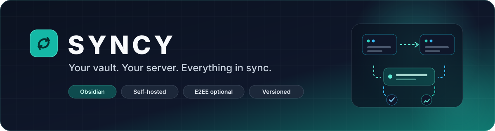
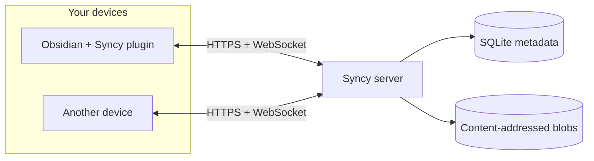
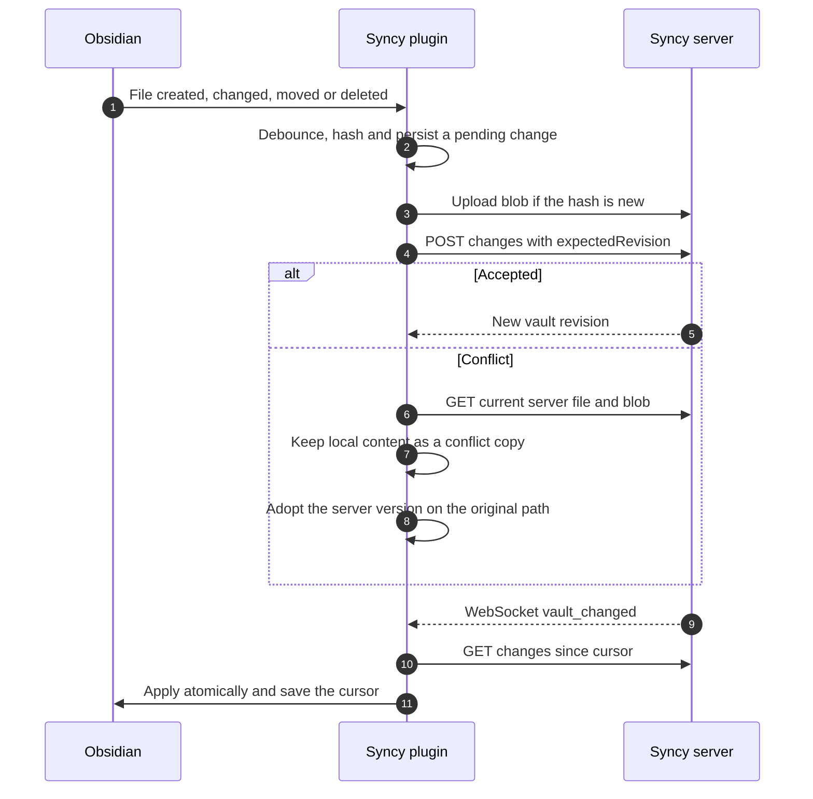

<div align="center">
  
  <h1>Syncy for Obsidian</h1>
  <p><strong>Your vault. Your server. Everything in sync.</strong></p>
  <p>Self-hosted sync for notes, attachments, plugins, themes, settings and version history.</p>
  <p>
    <a href="https://obsidian.md"></a>
    <a href="https://github.com/zazikii/Syncy-Obsidian-Plugin"></a>
    <a href="LICENSE"></a>
    <a href="#a-note-on-vibecoding"></a>
    <a href="#contributing"></a>
  </p>
  <p>
    <a href="#why-syncy">Why Syncy</a> ·
    <a href="#installation">Install</a> ·
    <a href="#setup">Setup</a> ·
    <a href="#sync-model">Sync model</a> ·
    <a href="#end-to-end-encryption">E2EE</a> ·
    <a href="#development">Development</a> ·
    <a href="#license-and-usage">License</a>
  </p>
</div>

> [!WARNING]
> **Vibecoded.** Syncy was built with heavy AI assistance. It has a real integration test suite and is designed carefully, but it is young software. Review the code, run the tests, keep independent backups, and do not treat it as the only copy of important data.

> [!NOTE]
> **Open code and public repository, free to use.** The complete source is available to clone, fork, modify and self-host. You may **not** sell it or publish a paid version. Read the [license and usage notice](#license-and-usage).

<details>
<summary><strong>Contents</strong></summary>

- [Why Syncy](#why-syncy)
- [Feature overview](#feature-overview)
- [Architecture](#architecture)
- [Requirements](#requirements)
- [Installation](#installation)
- [Quick start](#quick-start)
- [Setup](#setup)
- [What gets synced](#what-gets-synced)
- [Sync model](#sync-model)
- [Version history](#version-history)
- [End-to-end encryption](#end-to-end-encryption)
- [Settings reference](#settings-reference)
- [Commands](#commands)
- [Local data](#local-data)
- [Security](#security)
- [Troubleshooting](#troubleshooting)
- [Development](#development)
- [Roadmap](#roadmap)
- [Limitations](#limitations)
- [Contributing](#contributing)
- [License and usage](#license-and-usage)
- [A note on vibecoding](#a-note-on-vibecoding)

</details>

## Why Syncy

| | |
| --- | --- |
| **Your infrastructure** | Your server, your disk, your rules. No monthly per-vault sync bill. |
| **Everything syncs** | Notes, attachments, folders, community plugins, plugin data, themes, snippets, hotkeys and settings. |
| **Conflict-safe** | Per-file revisions, path conflict detection, atomic multi-file batches and tombstones. |
| **History included** | Every accepted change is versioned. Browse, preview and restore old note or file versions. |
| **Encryption optional** | E2EE vaults store opaque paths and ciphertext. The server never receives the vault key. |
| **Large vaults first** | Paginated snapshots, content-addressed blobs, target-only conflict checks and indexed change feeds. |
| **Real-time** | WebSocket notifications wake clients immediately. The durable change feed does the rest. |
| **Multi-device** | Device registration, rotating refresh tokens, reuse detection and instant device revocation. |
| **Boring to run** | One Node process, SQLite, a data directory, Docker Compose and a health check. |

Syncy is the companion plugin for the [Syncy server](https://github.com/zazikii/Syncy). The server is content-agnostic, so notes, plugins, themes and vault configuration all use the same reliable file protocol.

> [!IMPORTANT]
> Syncy is **not** compatible with Obsidian's official, private Sync protocol. It implements a clean API for its own companion plugin. It is also not affiliated with or endorsed by Obsidian.

## Feature overview

| Capability | What it gives you |
| --- | --- |
| **File sync** | Markdown, Canvas, databases, text, images, audio, video, PDFs and archives. |
| **Folder sync** | Empty folders, folder renames and folder tombstones. |
| **Configuration sync** | `.obsidian` settings, themes, snippets and community plugin bundles. |
| **Selective sync** | Glob exclusions, workspace toggle and plugin-data opt-in. |
| **Stable identities** | Renames keep the same server file ID; path swaps apply atomically. |
| **Conflict copies** | Stale writes become `Note (conflict 2026-10-25 143512).md` instead of silent overwrites. |
| **Version history** | Per-file revisions with local preview and restore. |
| **Real-time updates** | Single-use WebSocket tickets, automatic reconnect and polling fallback. |
| **Durable queue** | Pending changes and cursors survive Obsidian restarts and network loss. |
| **E2EE** | AES-256-GCM for content and paths, HKDF key separation and PBKDF2 key envelopes. |
| **Role awareness** | Owners/editors push; readers fall back to pull-only automatically. |
| **Repair tools** | Full resync, local-state reset and automatic recovery from expired cursors. |

## Architecture



- The plugin talks to a versioned `/v1` Fastify API.
- SQLite in WAL mode stores accounts, devices, vaults, memberships, file metadata, versions and the change log.
- Content-addressed storage deduplicates identical bytes and historical versions.
- WebSocket notifications are hints. The durable change feed is the source of truth.

## Requirements

- **Obsidian 1.6.0 or newer**, desktop or mobile.
- A reachable **Syncy server**. Follow the [server quick start](https://github.com/zazikii/Syncy#quick-start).
- **HTTPS** is strongly recommended for any server that is not on localhost.
- Node.js 22 or newer only if you build the plugin from source.

## Installation

Syncy is not in the Obsidian community plugin store yet. Build it and copy the result into your vault:

```bash
git clone https://github.com/zazikii/Syncy-Obsidian-Plugin.git
cd Syncy-Obsidian-Plugin
npm install
npm run build
```

Copy `main.js`, `manifest.json` and `styles.css` into:

```text
<your-vault>/.obsidian/plugins/syncy/
```

Then open **Settings → Community plugins**, reload Obsidian, and enable **Syncy**.

### Development install

Link the repository into your vault instead of copying on every build:

```bash
# macOS / Linux
ln -s "$(pwd)" "<your-vault>/.obsidian/plugins/syncy"

# Windows PowerShell (run as administrator)
New-Item -ItemType Junction -Path "<your-vault>\.obsidian\plugins\syncy" -Target "<repo>"
```

Run `npm run dev` for a watch build. Reload the plugin in Obsidian after rebuilding.

## Quick start

If your server is not running yet:

```bash
git clone https://github.com/zazikii/Syncy.git
cd Syncy
cp .env.example .env
# Edit .env: set SYNCY_EMAIL and SYNCY_PASSWORD
docker compose up -d --build
docker compose logs -f syncy
```

Check it:

```bash
curl http://localhost:8080/healthz
```

Then install the plugin and continue with [Setup](#setup).

## Setup

1. Start your Syncy server and create the account from its `.env` or with `POST /v1/setup`.
2. Open **Settings → Syncy**.
3. Enter the server URL, email and password, then click **Sign in**.
4. Choose an existing remote vault and click **Link**, or enter a name and click **Create vault**.
5. If the vault is end-to-end encrypted, enter the E2EE passphrase when prompted.

Syncy immediately runs an initial sync:

1. The server snapshot is downloaded page by page.
2. Local files are compared with the snapshot.
3. Local-only files are queued for upload.
4. Changes that happened during the snapshot are replayed from the change feed.

For a large existing vault this may take a while. The status bar shows progress.

### Multiple devices

Repeat the setup on each device and link the **same** remote vault. Devices authenticate with their own refresh token and appear separately in the server's device list.

Never link two different remote vaults to the same local Obsidian vault at the same time.

## What gets synced

| Included by default | Excluded by default |
| --- | --- |
| Notes, canvases, databases, PDFs and other attachments | `.trash/**` and `.git/**` |
| Empty folders and folder renames | OS junk: `.DS_Store`, `Thumbs.db`, `desktop.ini` |
| `.obsidian/app.json`, `appearance.json`, `hotkeys.json`, `core-plugins.json`, `community-plugins.json`, `themes.json` | `.obsidian/workspace.json`, `.obsidian/workspace-mobile.json`, `.obsidian/workspaces.json` |
| `.obsidian/themes/**` and `.obsidian/snippets/**` | `.obsidian/plugins/*/data.json` unless plugin-data sync is enabled |
| `.obsidian/plugins/**` bundles, manifests and styles | The Syncy plugin folder and its local sync state |

Syncy rescans `.obsidian` on each sync because Obsidian does not consistently emit vault events for its configuration directory. This also catches settings changed while the plugin was disabled.

The **Sync** section of the settings lets you:

- Disable periodic polling or real-time notifications.
- Exclude additional paths with one glob per line (`*`, `**`, `?`).
- Sync workspace layouts, which are usually device-specific.
- Sync community plugin `data.json` files, which may contain API keys and tokens.
- Trigger a manual sync, full resync or local-state reset.

When you change exclusions, Syncy stops managing the affected paths locally but **does not delete them from the server**.

## Sync model



### Local changes

- The file watcher is debounced to coalesce rapid saves.
- Content is hashed before pushing. Unchanged files are skipped.
- Pending changes are written to a durable queue before network work starts.
- Uploads use a small concurrency limit so large imports do not flood the server.

### Remote changes

- The change feed is pulled page by page against a fixed `until` revision.
- Revisions are applied in order and are idempotent across crashes.
- Files are written through a temporary file and renamed into place.
- Cursors are saved only after a page is fully applied.
- `410 CURSOR_EXPIRED` and `410 CURSOR_AHEAD` automatically trigger a paginated full resync.

### Conflict handling

Every pushed change carries the last applied server revision. If another device wrote first, Syncy:

1. Downloads the server version.
2. Keeps your local content in a copy such as `Note (conflict 2026-10-25 143512).md`.
3. Writes the server version to the original path.
4. Syncs the conflict copy as a new file.

Path collisions are handled the same way. Nothing is silently overwritten.

### Real-time updates

1. The plugin requests a single-use WebSocket ticket.
2. It subscribes to the linked vault.
3. On `vault_changed`, it pulls the durable change feed.
4. On disconnect, it reconnects with exponential backoff and re-subscribes.
5. Periodic polling remains available as a fallback and for mobile background limits.

### Large vaults

- Initial snapshots are paginated and bounded in memory.
- The full vault is never fetched in one response.
- Pushes are batched; related renames and swaps are atomic.
- Path checks only inspect paths touched by the batch.
- The pending queue and cursor survive restarts.
- Very large vaults benefit from extra server rate-limit headroom and SSD storage.

## Version history

Open the command palette and run **Syncy: version history for the current file**, or right-click a synced file and choose **Syncy: version history**.

The history modal lists stored revisions. You can:

- Preview text versions locally.
- Restore a version as a new change.
- Browse older pages of history.
- Decrypt and preview versions from E2EE vaults when the vault is unlocked.

Binary versions can be restored but are not previewed. Restoring never deletes the current version; it becomes another revision.

## End-to-end encryption

Create a vault with **End-to-end encryption** enabled, or unlock an existing encrypted vault with its E2EE passphrase.

| Layer | Implementation |
| --- | --- |
| **Content** | AES-256-GCM with a fresh nonce per version and the stable file ID as associated data. |
| **Paths** | AES-256-GCM, encoded as opaque base64url strings. |
| **File IDs** | HMAC-SHA256 of the normalized path during initial seeding, then stable across renames. |
| **Keys** | A random 256-bit vault key, split with HKDF into content, path and file-ID keys. |
| **Key envelopes** | The vault key is wrapped with a PBKDF2-SHA256 (600,000 iterations) key derived from the E2EE passphrase. |
| **Server storage** | The server stores only ciphertext, opaque paths, sizes, hashes and the wrapped envelope. |

The E2EE passphrase is never sent to the server and cannot be recovered by it. A separate login password is used for authentication.

If **Remember key on this device** is enabled, the unlocked vault key is stored in the plugin's local `data.json`. Disable it and enter the passphrase after each Obsidian restart for stricter security.

Sharing encrypted vaults, key rotation and member key distribution are server capabilities but not yet exposed in this plugin's UI.

## Settings reference

| Setting | Purpose |
| --- | --- |
| **Server URL** | Base URL of your Syncy server, without `/v1`. Locked while signed in. |
| **Email / Password** | Account credentials. The password is used once and is not stored. |
| **Device name** | Name used for new sign-ins and reconnects. |
| **Remote vault** | Existing server vault to link, or a name for a new vault. |
| **End-to-end encryption** | Create a new E2EE vault with a passphrase. |
| **Link / Relink / Unlink** | Start or stop syncing a remote vault without deleting remote data. |
| **E2EE passphrase** | Unlock an encrypted vault on this device. Never sent to the server. |
| **Remember key** | Persist the unlocked vault key in local plugin data. |
| **Enable sync** | Turn syncing on or off for the linked vault. |
| **Real-time notifications** | Keep a WebSocket open for immediate remote updates. |
| **Sync on startup** | Run a sync as soon as Obsidian opens. |
| **Polling interval** | Seconds between periodic checks; `0` disables the timer. |
| **Sync Obsidian configuration** | Include `.obsidian` settings, themes, snippets and plugins. |
| **Sync workspace layout** | Share device-specific workspace files. |
| **Sync community plugin data** | Include plugin `data.json` files, which may contain tokens. |
| **Excluded paths** | One vault-relative glob per line. |
| **Manual sync** | Sync now, full resync or reset local state. |

## Commands

| Command | Purpose |
| --- | --- |
| **Syncy: sync now** | Pull and push immediately. |
| **Syncy: full resync** | Re-read the paginated server snapshot, reconcile local files, then resume the change feed. |
| **Syncy: reset local sync state** | Forget cursor, file IDs, revisions and pending metadata; rebuild from the server without deleting local files. |
| **Syncy: version history for the current file** | Open stored versions for the active file. |
| **Syncy: sign out** | Stop sync and revoke this device's session. |

The ribbon icon and status bar also trigger and report syncs.

## Local data

Syncy stores its own state under:

```text
.obsidian/plugins/syncy/
  data.json                    settings, refresh token, optional saved vault keys
  sync-state/<vault-id>.json   cursor, file IDs, revisions, hashes and pending changes
```

This folder is always excluded from sync. Keep it out of backups that you would not trust with credentials, or sign out and remove saved keys first.

## Security

- Use HTTPS. Plain HTTP exposes credentials and content to the network.
- The login password is used once and is not stored. Refresh tokens rotate on every use.
- `data.json` contains a refresh token and, if enabled, saved vault keys. Protect your vault folder.
- Prefer E2EE for vaults containing plugin data with API tokens.
- The server administrator can read non-E2EE vault contents.
- Removing a member or deleting a vault does not erase copies other devices already downloaded.

See the [server E2EE threat model](https://github.com/zazikii/Syncy/blob/main/docs/E2EE.md) before trusting Syncy with highly sensitive data.

## Troubleshooting

<details>
<summary><strong>Status bar says offline or error</strong></summary>

Check that the server URL is correct and reachable from this device, that HTTPS certificates are valid, and that the server is running. Syncy retries with exponential backoff. The latest error is in the status bar tooltip and settings summary.

</details>

<details>
<summary><strong>Obsidian configuration is not syncing</strong></summary>

Enable **Sync Obsidian configuration** in the Syncy settings. Check that `.obsidian` or specific config paths are not in the exclusion list. Workspace files stay excluded unless you enable workspace sync. Syncy rescans the config directory every sync, so changes made while the plugin was disabled are picked up.

</details>

<details>
<summary><strong>Conflict copies keep appearing</strong></summary>

Two devices edited the same file before syncing. Syncy keeps both versions rather than guessing. Open the conflict copy, merge anything you need, then delete it. Configuration files can conflict when two devices change the same setting at once; pick one device as the source of truth for those settings.

</details>

<details>
<summary><strong>The encrypted vault is locked</strong></summary>

Open **Settings → Syncy → Encryption**, enter the E2EE passphrase and click **Unlock**. If the passphrase is lost, the server cannot recover it. If another member added you to the vault without a key envelope, ask the owner for one.

</details>

<details>
<summary><strong>A file is too large</strong></summary>

The server's `MAX_BLOB_BYTES` limits one file. Raise it on the server if you need larger attachments, or exclude the file. Syncy reports the limit rather than silently failing the file.

</details>

<details>
<summary><strong>Sync says read-only</strong></summary>

Your account has the `reader` role on that vault. Pulling continues, but pushing is disabled. Ask the owner for the `editor` role.

</details>

<details>
<summary><strong>Cursor expired or ahead</strong></summary>

The server pruned old history or was restored from a backup. Syncy detects `410` responses and runs a paginated full resync automatically. You can also run **Syncy: full resync** manually.

</details>

<details>
<summary><strong>Rate limited during a large import</strong></summary>

Raise `RATE_LIMIT_MAX` on the server for the initial import, or let Syncy back off. Uploads are already limited to a small concurrency.

</details>

## Development

```bash
npm install
npm run dev         # watch build
npm run typecheck
npm run lint
npm test
npm run build       # typecheck + production bundle
npm run check       # typecheck + lint + unit tests
```

### Tests

The unit tests cover:

- E2EE primitives, path encryption and key envelopes.
- Path normalization, conflict-copy naming and glob exclusions.
- Encoding and SHA-256 helpers.
- Durable sync-state persistence, queue coalescing and file-ID indexes.

An optional integration suite exercises the real engine against a live server:

```bash
SYNCY_TEST_URL=http://127.0.0.1:8080 \
SYNCY_TEST_EMAIL=you@example.com \
SYNCY_TEST_PASSWORD=your-password \
npm run test:integration
```

It creates and deletes temporary vaults on the server and covers initial import, edits, renames, deletes, path swaps, conflicts, config-directory changes, stale cursors, remote moves/deletes, real-time notifications and encrypted sync.

The integration suite is skipped automatically when `SYNCY_TEST_URL`, `SYNCY_TEST_EMAIL` or `SYNCY_TEST_PASSWORD` is missing.

### Source layout

| Path | Responsibility |
| --- | --- |
| `src/main.ts` | Plugin lifecycle, commands, account/vault linking, status bar. |
| `src/api.ts` | `/v1` client, token refresh, blobs, changes and versions. |
| `src/sync/engine.ts` | Snapshot import, pull/apply, watcher queue, config scan, batched push and conflicts. |
| `src/state.ts` | Durable per-vault cursor, file-ID map and write-ahead pending queue. |
| `src/realtime.ts` | WebSocket tickets, subscriptions and reconnect backoff. |
| `src/crypto.ts` | E2EE content/path encryption, file-ID derivation and key envelopes. |
| `src/ui/` | Settings tab, passphrase/confirmation dialogs and version history. |
| `src/util/` | Paths, globs, hashing, encoding and errors. |
| `tests/` | Unit tests and the optional live-server integration suite. |

## Roadmap

- [x] Initial sync, change feed and cursor recovery
- [x] Batched pushes, atomic renames and path swaps
- [x] Conflict copies and version history
- [x] Real-time WebSocket notifications
- [x] Optional E2EE vaults
- [x] Raw `.obsidian` configuration sync
- [x] Live-server integration tests
- [ ] Obsidian community plugin release
- [ ] E2EE member sharing and key rotation UI
- [ ] Structured vault-settings document support
- [ ] Streaming large-blob transfers
- [ ] Side-by-side conflict diff view
- [ ] Translations

## Limitations

- The structured `/v1/vaults/:id/settings` document is not used; vault configuration syncs as raw `.obsidian` files.
- Blob uploads and downloads buffer the file through Obsidian's `requestUrl`; very large attachments use proportional memory.
- There is no side-by-side merge or diff editor for conflicts, only conflict copies.
- E2EE vault sharing and key rotation need to be done outside this plugin for now.
- One remote vault per Obsidian vault.
- File modification timestamps are not restored locally after a remote apply; Obsidian may show the download time as the local modified time.

## Contributing

Bug reports, protocol feedback, security reviews and pull requests are welcome.

1. Fork the repository.
2. Create a focused branch.
3. Run `npm run check` and `npm run build`.
4. Add tests for behavior changes.
5. Open a pull request describing the problem and the fix.

Please keep the sync semantics and tests intact. Do not include credentials, vault data, tokens or server secrets in issues or pull requests.

By contributing, you agree that your contribution is licensed under the same [PolyForm Noncommercial license](LICENSE) and may not be used to create a paid version of Syncy.

## License and usage

Syncy is licensed under the **PolyForm Noncommercial License 1.0.0**.

[Read the full license](LICENSE) · [Official license text](https://polyformproject.org/licenses/noncommercial/1.0.0)

**You may:**

- Read, clone, fork and study the source.
- Modify it for personal, hobby, research, educational or other noncommercial use.
- Self-host it for yourself, your family, a charity, a school or a government institution.
- Share copies and changes, provided recipients receive the same license terms and the Required Notice.

**You may not:**

- Sell Syncy or publish a paid version.
- Use it as part of a commercial product or paid service.
- Sublicense it under different terms or remove the license notice.

**Required Notice:** Copyright (c) 2026 Syncy contributors

Because commercial use is restricted, Syncy is **source-available and free to use** rather than an OSI-approved open-source license. The source is public, the code can be inspected and improved by anyone, and no paid version is authorized.

## A note on vibecoding

Syncy was built with heavy AI assistance and human direction. That makes it fast to evolve, but it also means the code deserves the same scrutiny as any young project.

Before trusting it with important data:

- Read the relevant source.
- Run the tests.
- Try it on a copy of your vault.
- Keep independent backups.
- Use HTTPS and E2EE when appropriate.

If you find a bug or a security issue, please open an issue with a minimal reproduction. Do not include vault contents or secrets.

## Repository

- **Plugin:** [github.com/zazikii/Syncy-Obsidian-Plugin](https://github.com/zazikii/Syncy-Obsidian-Plugin)
- **Server:** [github.com/zazikii/Syncy](https://github.com/zazikii/Syncy)
- **Issues:** [github.com/zazikii/Syncy-Obsidian-Plugin/issues](https://github.com/zazikii/Syncy-Obsidian-Plugin/issues)

---

<div align="center">
  <sub>Built for people who would rather own their sync.</sub>
</div>
